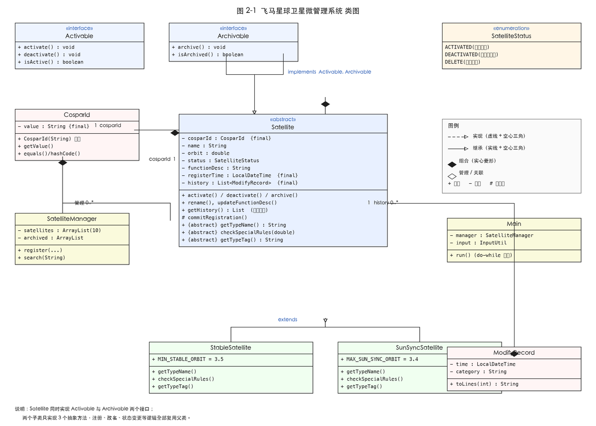

# 飞马星球卫星微管理系统

面向对象程序设计（Java）大作业一 —— 字符界面微管理系统。

在**华为云鲲鹏（aarch64）openEuler 22.03 LTS** 上用 **毕昇 JDK 8** 编译运行，
采用封装、继承、接口等面向对象技术实现卫星轨道资源的管理。

## 功能

| 编号 | 功能 | 菜单项 |
| --- | --- | --- |
| F01 | 显示当前卫星列表 | 1 |
| F02 | 注册添加新卫星（含规则校验） | 2 |
| F03 | 删除旧卫星并归档 | 3 |
| F04 | 激活卫星 | 4 |
| F05 | 封锁（失活）卫星 | 5 |
| F06 | 显示失活卫星列表 | 6 |
| F07 | 按 id 或名称模糊查找并显示详细信息 | 7 |
| F08 | 修改卫星名称信息 | 8 |
| F09 | 查看和修改卫星具体功能和注意事项 | 9 |
| F10 | 查看注册时间和历次修改时间和修改事项 | 10 |
| — | 退出系统 | 0 |

## 业务规则

- 最低卫星轨道为 `1.2`，任意两颗在用卫星的轨道间距不小于 `0.2`
- COSPARID 共 6 位：2 位国家编码 + 4 位数字，分配后不可修改
- 卫星状态：`ACTIVATED`（激活可用）/ `DEACTIVATED`（封锁非激活）/ `DELETE`（报废归档）
- 报废须先封锁再删除，删除后信息归档保存，该 COSPARID 永久禁用
- 注册时间与每次修改时间由系统自动产生，不允许人工修改
- 启动时预加载 6 颗卫星，`ArrayList` 初始容量为 10

## 编译与运行

需要 JDK 8 及以上（在 JDK 8 / JDK 21 上均验证通过）。

```bash
# 编译（JDK 8 的 javac 不会自动创建输出目录，先 mkdir）
mkdir -p out
javac -encoding UTF-8 -d out src/*.java

# 运行
java -cp out Main
```

中文乱码时追加编码参数：

```bash
java -Dfile.encoding=UTF-8 -cp out Main
```

### 交互测试

`test-cases/` 中保存了各功能的输入脚本，可直接重定向运行：

```bash
java -cp out Main < test-cases/case_F01.txt
```

### 业务规则自检

项目附带 33 个断言的自检程序，可用于快速验证 11 条业务规则：

```bash
java -cp out Main check
```

输出 `通过 33 项，失败 0 项 / 全部通过` 即表示全部规则生效。

## 目录结构

```
FM_320250901191_乐豆芽/
├── src/                     源代码（17 个 .java，共 2711 行）
│   ├── Main.java            程序入口与菜单循环（全程序唯一的 static 方法 main）
│   ├── SatelliteManager.java 业务规则守门员
│   ├── Satellite.java       抽象父类：共有属性与状态机
│   ├── StableSatellite.java 静止轨道卫星（轨道 ≥3.5）
│   ├── SunSyncSatellite.java 太阳同步轨道卫星（轨道 ≤3.4）
│   ├── Activable.java       可激活接口
│   ├── Archivable.java      可归档接口
│   ├── CosparId.java        不可变值对象：6 位标识校验
│   ├── ModifyRecord.java    不可变修改记录
│   ├── SatelliteStatus.java 状态枚举
│   ├── TextLayout.java      终端排版（中文占两列）
│   ├── InputUtil.java       输入工具（非法输入重试）
│   ├── RuleChecker.java     业务规则自检程序
│   └── ...                  异常与测试辅助类
├── test-cases/              交互测试输入脚本（case_F01 ~ case_F10 等）
├── screenshots/             运行截图（图 4-0 ~ 图 5-1）
├── diagrams/                类图与流程图
└── FM_320250901191_乐豆芽_作业报告.docx   作业报告
```

## 类图



## 设计要点

1. **封装**：`CosparId` 构造时校验、字段 `final`、无 setter；状态只能通过
   `activate()` / `deactivate()` / `archive()` 改变，每次变更自动记录时间戳；
   `getHistory()` 返回只读视图。
2. **继承**：抽象类 `Satellite` 抽取共有属性与行为，三个抽象方法
   `getTypeName()`、`checkSpecialRules()`、`getTypeTag()` 把差异交给子类。
3. **接口**：`Activable` 与 `Archivable` 定义能力契约，`SatelliteManager` 面向接口调用。
4. **约束**：除 `main` 外不使用 static 方法，不使用内部类；界面层与业务层完全分离。

## 运行环境

| 项目 | 版本 |
| --- | --- |
| 云平台 | 华为云鲲鹏弹性云服务器（aarch64 架构） |
| 操作系统 | openEuler 22.03 LTS |
| JDK | OpenJDK 1.8.0_412（Bisheng build） |
| 编译命令 | `javac -encoding UTF-8 -d out src/*.java` |
| 运行命令 | `java -cp out Main` |
